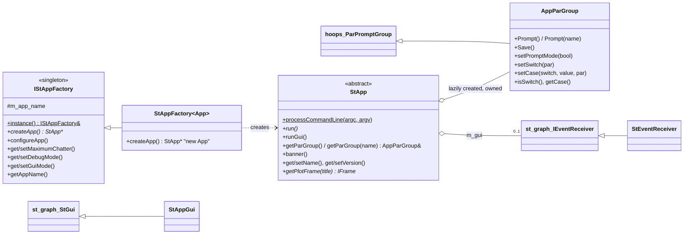

# st_app Architecture

**st_app** is the skeleton every compiled Fermitools application is built
on. A tool supplies only two things: a subclass of `st_app::StApp` with a
`run()` method, and a global `st_app::StAppFactory<MyApp>` object naming
the tool. The library supplies **`main()` itself** (`src/ballistic_main.cxx`).
It also handles parameter file access through hoops, the standard hidden
parameters (`chatter`, `debug`, `gui`), the startup banner, top-level
exception handling, floating-point traps and the optional parameter GUI.

Other packages' architecture docs refer to this file for "the standard
st_app startup". The [startup sequence](#startup-and-teardown-sequence)
below is the authoritative description.

The Doxygen mainpage (`src/mainpage.h`) is partly stale. It promises
`-help`, `-version`, `-debug` and `-gui` command-line options, but
`StApp::processCommandLine` only stores `argc`/`argv` and implements no
options. It also refers to an `st_app_examples` package that does not
exist in this repository.

## Purpose and scope

**Does:**
- Provide the process entry point `main()` for every tool executable that
  links `st_app`.
- Find and create the application object through a singleton factory that
  is registered by static initialisation.
- Read `chatter`, `debug` and `gui` from the tool's par file before the
  application exists. Use them to configure `st_stream` and to choose GUI
  or command-line mode.
- Wrap hoops (`hoops::ParPromptGroup`) as `AppParGroup`. This adds prompt
  suppression and "switch/case" metadata, so that parameters can be
  prompted or shown conditionally.
- Turn uncaught `std::exception`s into a one-line message and exit status 1.
- Enable floating-point exception traps (Linux).
- Provide two parameter-entry GUIs: the old `StEventReceiver` and the newer
  `StAppGui`, both drawn through `st_graph`. Also provide a lazily created
  plot window (`StApp::getPlotFrame`).

**Does not:**
- Parse par files or command-line `name=value` arguments. hoops and ape do
  that (see `src/hoops/` and `src/ape/`).
- Act on `clobber` or `mode`. `clobber` is read by each tool if it
  supports it. `mode` is interpreted by hoops/ape. st_app only skips these
  two in the GUI.
- Provide help text. That is in `fermitools-fhelp`.
- Provide Python tool wrappers. `sane` (`gt_apps`) runs the compiled
  executables. `pyLikelihood` exposes `StApp`/`AppParGroup` through SWIG
  for par-file access from Python.

## Position in the system

| Direction | Package | Why |
|-----------|---------|-----|
| Depends on | `hoops` (PUBLIC) | `AppParGroup` derives from `hoops::ParPromptGroup`. Clients use the hoops `IPar` conversion operators (`int n = pars["x"]`). |
| Depends on | `st_stream` (PRIVATE) | `configureApp` connects the global streams and sets exec name, chatter and debug. `banner()` and the GUIs write through `StreamFormatter`. |
| Depends on | `st_graph` (PRIVATE) | `StApp::runGui`, `StApp::getPlotFrame`, `StAppGui` and `StEventReceiver` use `st_graph::Engine`. **Public** headers `st_app/StGui.h` and `st_app/StAppGui.h` include `st_graph` and `st_stream` headers, so a client that includes them must link `st_graph` itself (as `burstFit` does). |
| Depends on | `facilities` (PRIVATE) | `main()` calls `facilities::commonUtilities::setupEnvironment()`. |
| Test only | CppUnit | Linked into `test_st_app`, but the test does not use CppUnit. |
| Used by | ~60 tool executables in 16 packages | Each defines `StApp` subclass(es) and a factory: `Likelihood` (`gtlike`, `gtexpcube2`, `gtsrcmaps`, `gtltcube`, …), `dataSubselector` (`gtselect`, `gtmktime`, `gtvcut`), `evtbin` (`gtbin`, `gtbindef`), `timeSystem` (`gtbary`), `irfs` (`gtirfs`, `gtecorrect`, `make_fits`, `combine_irfs`), `SolarSystemTools`, `map_tools`, `observationSim` (`gtobssim`), `orbitSim` (`gtorbsim`), `pyExposure` (`gtexposure`), `rspgen` (`gtrspgen`), `burstFit` (`gtburstfit`), `sourceIdentify` (`gtsrcid`), `fitsGen`. |
| Used by | Libraries taking `AppParGroup&` | `evtbin::BinConfig`, `Likelihood::AppHelpers`, `Likelihood::BinnedExposure*`, `dataSubselector::CutController`, `observationSim::ContainerBase`, `timeSystem::TimeCorrectorApp`. Through these, `st_app` is a dependency of the libraries, not just of the tools. |
| Used by | `pyLikelihood` | SWIG-wraps `StApp` and `AppParGroup` (`%include st_app/StApp.h`). Defines `StAppInterface` so Python can open a tool's par file. |
| Used by | `timeSystem` | `PulsarTestApp` runs other `StApp` objects in-process and saves and restores the `st_stream` globals around them. |

`dataSubselector`, `fitsGen` and `pyLikelihood` include `st_app` headers
without listing `st_app` in their own `target_link_libraries`. They get it
transitively (for example through `irfLoader`'s PUBLIC link or `evtbin`).
`sane` links it only for `test_sane`.

## Key abstractions

All types are in namespace `st_app`. Headers are in `st_app/`.



| Type | Header | Role |
|------|--------|------|
| `StApp` | `st_app/StApp.h` | Abstract application. Subclasses implement `run()`. It stores the command line in **statics** (`s_argc`, `s_argv`), owns the lazily created `AppParGroup`, the name and version, and an optional GUI and plot window. |
| `IStAppFactory` | `st_app/StAppFactory.h` | Singleton. The **first** factory constructed registers itself in `s_factory`. `configureApp()` reads the standard parameters. |
| `StAppFactory<App>` | `st_app/StAppFactory.h` | `createApp()` returns `new App`. The constructor argument is the **tool name**. It is used to find the par file and becomes the app's name. |
| `AppParGroup` | `st_app/AppParGroup.h` | `hoops::ParPromptGroup` built from `StApp::getArgc()-1`, `getArgv()+1` and the component name. Adds a prompt-mode switch (`setPromptMode(false)` makes `Prompt` do nothing) and switch/case metadata. |
| `StEventReceiver`, `st_app::ParWidget` | `st_app/StGui.h` | The **old** parameter GUI. `StApp::runGui()` builds it by default. It edits the app's own `AppParGroup` directly. |
| `StAppGui` | `st_app/StAppGui.h` | The **newer** GUI. It derives from `st_graph::StGui`, which works on a *clone* of the par group, and implements `runApp()` by copying widget values back into the app's group. It is used when a tool overrides `runGui()` (only `gtburstfit` and `test_st_app`). |

### Standard parameters

Every tool par file ends with the same hidden block (for example
`src/evtbin/pfiles/gtbin.par`):

```
chatter, i, h, 2, 0, 4,  "Chattiness of output"
clobber, b, h, yes, , ,  "Overwrite existing output files with new output files"
debug,   b, h, no, , ,   "Debugging mode activated"
gui,     b, h, no, , ,   "GUI mode activated"
mode,    s, h, "ql", , , "Mode of automatic parameters"
```

| Parameter | Consumer | Effect |
|-----------|----------|--------|
| `chatter` | `IStAppFactory::configureApp` → `st_stream::SetMaximumChatter` | Sets the threshold for `StreamFormatter::info(n)`/`warn(n)`. |
| `debug` | `configureApp` → `st_stream::SetDebugMode`; then `main()` | Enables `debug()` streams and class::method prefixes. It **also runs the app outside the top-level try/catch** (see below). |
| `gui` | `configureApp` → `m_gui_mode` | `main()` calls `runGui()` instead of `run()`. |
| `clobber` | the individual tool, if at all | Not touched by st_app. |
| `mode` | hoops/ape | Controls which parameters are prompted (`ql`, `h`, …). Skipped by the GUI. |

If any of these parameters is missing, its `hoops::Hexception` is swallowed
and the default stays in place: chatter `UINT_MAX` (everything shown),
debug off, GUI off.

## Data flow and control flow

### Startup and teardown sequence

From `src/ballistic_main.cxx`, `src/StAppFactory.cxx` and `src/StApp.cxx`.
This is the same for every tool linked against `st_app` that does not
define its own `main`.

```
[static init]  global StAppFactory<MyApp> g_factory("gtfoo")
               → IStAppFactory ctor: s_factory = this (first one wins)

main(argc, argv)
  status = 0; app = 0; debug = gui = false
  try {
    feenableexcept(FE_INVALID | FE_DIVBYZERO | FE_OVERFLOW)   // only if TRAP_FPE (all non-Apple builds)
    facilities::commonUtilities::setupEnvironment()            // sets <PKG>XMLPATH/<PKG>DATAPATH env vars
    StApp::processCommandLine(argc, argv)                      // just stores them in statics
    IStAppFactory::instance().configureApp()
      st_stream::OStream::initStdStreams()                     // connect sterr/stlog/stout
      if factory has a name:
        st_stream::SetExecName(name)
        AppParGroup pars(name)          // throwaway group: reads par file + command line
        chatter → SetMaximumChatter     // each read in its own try; Hexception ignored
        debug   → SetDebugMode          // (ST_APP_DEBUG compile flag forces true; not set in CMake)
        gui     → m_gui_mode
    debug = factory.getDebugMode(); gui = factory.getGuiMode()
    if (!debug) {
      app = factory.createApp()                // MyApp ctor runs here
      app->setName(factory.getAppName())       // overrides any name set in the ctor
      app->banner()                            // info(1): "This is gtfoo version Fermitools-X.Y.Z"
      gui ? app->runGui() : app->run()
    }
  } catch (const std::exception & x) {
    status = 1
    std::cerr << "Caught " << typeid(x).name() << " at the top level: " << x.what()
  }
  if (debug) {                                 // NOT inside any try/catch
    if (!app) { app = createApp(); app->setName(...) }
    app->banner(); gui ? app->runGui() : app->run()
  }
  delete app                                   // ~StApp deletes par group, GUI, plot main frame
  return status
```

The `std::logic_error` rethrown around `createApp()` ("Failed to get an
StAppFactory singleton: client must define one") is raised only when
`instance()` itself throws. In practice that happens earlier, in
`configureApp()`, with the message
`IStAppFactory::instance() cannot find a factory`.

### Exit status and error reporting

| Situation | What the user sees | Exit status |
|-----------|-------------------|-------------|
| `run()` returns normally | Tool output | 0 |
| `run()` (or the app constructor, or `configureApp`) throws a `std::exception` subclass, including `hoops::Hexception`, `tip::TipException` and `std::runtime_error` | `Caught <mangled type name> at the top level: <what()>` on stderr | 1 |
| Something throws a non-`std::exception` type | `std::terminate` → abort | 134 (SIGABRT) |
| A trapped FP exception occurs (division by zero, invalid, overflow) | Process killed by SIGFPE, **no message** | 136 |
| `debug=yes` and anything throws | Uncaught → `std::terminate` → abort (core dump, if enabled), so a debugger stops at the throw | 134 |
| `gui=yes` and the app fails | The GUI catches it and prints `Running the application failed: …` to `err()`. The GUI keeps running. | 0 when the window is closed |

The type name comes from `typeid(x).name()`. With GCC and Clang this is
the **mangled** name, for example `St13runtime_error` or
`N4hoops10HexceptionE`.

### Parameter access inside a tool

The idiomatic pattern, used for example by `gtbin`, `gtselect` and
`gtexpcube2`:

```cpp
class MyApp : public st_app::StApp {
 public:
  MyApp() : m_pars(getParGroup("gtfoo")) { setName("gtfoo"); setVersion(s_cvs_id); }
  void run() override {
    m_pars.Prompt();                  // or Prompt("name") for specific parameters
    m_pars.Save();                    // write the user's copy of gtfoo.par
    std::string infile = m_pars["infile"];
    double emin = m_pars["emin"];
    ...
  }
 private:
  st_app::AppParGroup & m_pars;
};
st_app::StAppFactory<MyApp> g_factory("gtfoo");
```

`s_cvs_id` is conventionally `"$Name:  $"`. `setVersion` sees the empty
CVS tag and substitutes `ST_APP_RELEASE`, which is
`"Fermitools-${FERMITOOLS_RELEASE}"` baked in when `st_app` is compiled.
A version string without `$Name:` is used verbatim. A blank one becomes
`N/A`.

### Switch/case prompting

`setSwitch("alg")` marks parameter `alg` as a switch.
`setCase("alg", "LC", "tstart")` says `tstart` is relevant only when
`alg == "LC"`. The comparison is case-insensitive: values and labels are
upper-cased. `AppParGroup::Prompt()` with no arguments then walks the
parameters **in par-file order**. It skips any parameter whose
switch/case conditions are not all satisfied by the switch's *current*
value. The GUIs use the same metadata to put parameters on tab pages
(`StEventReceiver::getParent`). Among built tools, only `gtlike`,
`gttsmap` and `gtexpmap` set switches today. `gtcntsmap.cxx` also sets
them but is not built, and the `gtbin` block is under `#if 0`.

### GUI mode

`StApp::runGui()` default behaviour:
- If the app has not installed a GUI (`m_gui == 0`), it creates the old
  `StEventReceiver` on `st_graph::Engine::instance()` and runs it.
- Otherwise it runs the installed `st_graph::StGui` or `StEventReceiver`.

The GUI calls `setPromptMode(false)` on the par group so that `run()`
never prompts on the terminal. It shows one widget per parameter, hiding
`gui` and `mode`; hidden parameters appear under "Show Advanced
Parameters". On **Run**, it copies the widget values into the group,
calls `Save()`, re-applies `chatter`/`debug`, and calls `m_app->run()`.
Run can be pressed several times on the same `StApp` object. **Cancel**
or closing the window stops the engine. `runGui()` then returns to
`main()`.

With the MPL engine (`st_graph`), the GUI needs a display, Tk and
matplotlib. If they are missing, the first widget creation throws
`std::runtime_error` and the tool exits with status 1.

## Public interfaces

### C++ API

| Header | Used by | Notes |
|--------|---------|-------|
| `st_app/StApp.h` | every tool | Base class. |
| `st_app/StAppFactory.h` | every tool, `timeSystem`, `sane` | Factory template and `IStAppFactory::instance()`. |
| `st_app/AppParGroup.h` | every tool and the libraries listed above | Parameter access. |
| `st_app/StAppGui.h` | `burstFit` (`gtburstfit`) | Newer GUI base. Pulls in `st_graph/StGui.h`. |
| `st_app/StGui.h` | `st_app` only | Old GUI (`StEventReceiver`). Public, but no external users. |

### Applications

| Executable | Source | Notes |
|------------|--------|-------|
| `st_app_main` | `src/st_app_main/TestApp1.cxx` | "Hello world" app with factory name `test_st_app`. **Installed to `bin`**. It is a demo, not a user tool. |
| `test_st_app` | `src/test/test_main.cxx` | Test program (see below). Par file `pfiles/test_st_app.par`, also installed to `syspfiles`. |

### Python

None in this package. `pyLikelihood` wraps `StApp`/`AppParGroup`.

### File formats

Par files only, through hoops and ape. st_app writes the user's par file
when a tool calls `Save()`.

## Build and test

- **CMake target:** `st_app` is a **STATIC** library. It contains
  `main()` (`ballistic_main.cxx`). Compile definitions are
  `ST_APP_RELEASE="Fermitools-${FERMITOOLS_RELEASE}"` (PRIVATE) and, on
  non-Apple systems, `TRAP_FPE`. Links: `hoops` PUBLIC; `st_graph`,
  `st_stream` and `facilities` PRIVATE.
- **How tools get `main`:** a tool executable defines no `main`. The
  linker pulls `ballistic_main.o` out of `libst_app.a` to resolve it. An
  executable that defines its own `main` (`test_st_graph`, for example)
  simply does not pull that object in.
- **Install:**
  - headers go to `include/st_app`
  - `pfiles/` goes to `${FERMI_INSTALL_PFILESDIR}`
  - `st_app_main` and `test_st_app` go to `bin`
- **`test_st_app`:**
  - It uses the st_app `main` and the `test_st_app` par file, so `PFILES`
    must find `test_st_app.par`. It is **not registered with CTest**.
  - It checks `setVersion` handling (blank, `$Name: $`, `$Name: v0 $`,
    custom), sets up switches and cases, sets `infile`/`outfile`/`binfile`
    to `.`, calls `Save()` (which **writes the user's local
    `test_st_app.par`**), and writes sample output to each
    `StreamFormatter` stream.
  - With `plot=yes` it opens a plot window. With `gui=yes` it runs both
    GUIs (needs a display).
  - Failure is a `std::runtime_error("Test failed")`, which gives exit
    status 1.
  - Prompting is commented out so that it can run unattended.
- **Legacy:** `SConscript` and `st_appLib.py` belong to the old SCons
  build.

## Invariants and gotchas

**Startup and naming**
- The factory must be a **global object in the executable's own
  translation unit**. A factory placed in a static library is never
  linked in, and the tool fails with
  `IStAppFactory::instance() cannot find a factory`. If two factories
  exist, the first one constructed (in unspecified static-init order) wins.
- `main()` calls `setName(factory name)` *after* the constructor, so the
  factory name always wins. An **unnamed** factory (`StAppFactory<App> f;`)
  skips `configureApp`'s parameter reading entirely (no chatter, debug or
  gui), and also blanks the app name, so the banner says `This is  version …`.
  `exposureMap.cxx` and `sane_main.cxx` do this, but neither is built as a
  tool.
- `StApp::m_name` is `"Unknown application"` while the constructor runs.
  Tools therefore call `getParGroup("gtfoo")` with an explicit name in
  their constructors.
- `getParGroup(name)` creates the group **once** and caches it. Later calls
  with a different name silently return the first group.
- `configureApp` builds a **separate, temporary** `AppParGroup`, so the
  par file and command line are parsed twice. Errors in the first parse
  are swallowed. The same error then surfaces, uncaught by st_app, when
  the app builds its own group, giving exit 1.

**Exceptions, debug and exit codes**
- `debug=yes` changes **failure behaviour**, not just verbosity: the app
  runs outside the top-level `try`, so any exception aborts the process
  (exit 134, possible core file) instead of exiting 1 with a message.
  Scripts that set `debug=yes` see different exit codes.
- The comment "check debug status again in case the application
  constructor changed it" in `ballistic_main.cxx` is not implemented. The
  local `debug` flag is never re-read, so changing debug mode in a
  constructor does not move execution outside the try/catch.
- In GUI mode, application failures are caught and printed by the GUI,
  and the process exits 0.

**Floating-point traps**
- On Linux every st_app tool runs with `FE_INVALID | FE_DIVBYZERO |
  FE_OVERFLOW` **trapping enabled**. Code that is harmless elsewhere
  (`0./0.`, `log(0)` producing `-inf` with a divide-by-zero flag, overflow
  to `inf`) kills the tool with SIGFPE and no message. The same library
  code called from Python (pyLikelihood) does **not** trap unless the
  user opts in with `pyLikelihood.enableFPE()`, so behaviour can differ
  between `gtlike` and Python `BinnedAnalysis`. Calls into
  embedded Python must suspend the traps; `st_graph::PythonFpeGuard` and
  Likelihood's matplotlib code do this.

**Parameters**
- `AppParGroup`'s copy constructor does **not** copy switch/case
  metadata (it starts empty). `operator=` leaves the target's metadata
  unchanged. Only prompt mode is copied.
- Switch/case conditions on one parameter are **AND**ed. A parameter given
  two cases of the same switch (`setCase("alg","LC","x"); setCase("alg","PHA2","x")`)
  is never prompted by `Prompt()`, because one of the two always fails.
  The disabled `gtbin` code does exactly this for `tbinalg`/`ebinalg`.
- A switch is tested using its value at the moment the walk reaches the
  dependent parameter. The switch must therefore come **before** its
  dependents in the par file, or the decision uses the stale value.
- `setPromptMode(false)` disables `Prompt()` and `Prompt(name)` for that
  group. The GUIs leave it disabled after they exit.
- `AppParGroup` is constructed from `StApp::getArgc()-1` and
  `getArgv()+1`. When no `main` has called `processCommandLine` (for
  example `StAppInterface` in pyLikelihood), these are `-1` and
  `(char**)0 + 1`. hoops must tolerate this (from reading the code; not
  checked at runtime).

**Versioning**
- `ST_APP_RELEASE` is compiled into `libst_app.a` from the CMake cache
  variable `FERMITOOLS_RELEASE`. That variable is set from `PKG_VERSION`,
  `FERMITOOLS_VERSION` or `PROJECT_VERSION` **at first configure**, and
  as a cache variable it does not follow later environment changes. Every
  tool's banner version comes from this one value.

**Housekeeping**
- `st_app_main` is a demo executable but is installed to `bin` with the
  user tools.
- The library is static and contains `main`. Linking `st_app` into a
  shared library (as `Likelihood` and `irfLoader` do) is harmless only
  because nothing in a shared library references `main`.

## Extension points

- **New tool:**
  1. Subclass `StApp`, implement `run()`, and take
     `getParGroup("<tool>")` in the constructor.
  2. Define `st_app::StAppFactory<MyApp> g_factory("<tool>");` at global
     scope in the executable's `.cxx`.
  3. Add a par file to the package's `pfiles/` that ends with the standard
     hidden block (`chatter`, `clobber`, `debug`, `gui`, `mode`).
  4. In CMake, `add_executable(<tool> ...)` and link `st_app` (plus the
     package library). Do not write a `main`.
- **Conditional prompting / GUI tabs:** call `setSwitch` and `setCase` in
  the constructor. Keep each parameter to a single case per switch (see
  gotchas).
- **Custom GUI:** override `runGui()`. Construct a subclass of
  `st_app::StAppGui`, optionally call `enablePlotFrame(title)`, and run it
  (see `gtburstfit`).
- **Plots from a tool:** `getPlotFrame(title)` returns a lazily created
  `st_graph` plot frame. In GUI mode it returns the GUI's plot frame.
  Create plots in it with `st_graph::Engine::instance().createPlot(frame, …)`
  and call `Engine::instance().run()` to show them.
- **New standard parameter:** read it in `IStAppFactory::configureApp`
  (inside its own `try`/`catch (hoops::Hexception&)`), then add it to
  every par file. This is a cross-package change.

## Further reading

- `src/mainpage.h`: original design notes. The command-line option claims
  are stale; the exception-handling section is accurate.
- `src/test/test_main.cxx`: the most complete usage example (versions,
  switches, streams, plots, both GUIs).
- `src/hoops/` and `src/ape/`: par file syntax, `mode`, `PFILES` lookup
  and `Save()` semantics.
- `src/st_stream/doc/architecture/README.md`: what `chatter` and `debug`
  do to output.
- `src/st_graph/doc/architecture/README.md`: the engine behind the GUI and
  plot frames.
- `doc/release.notes`: history up to 2017.
